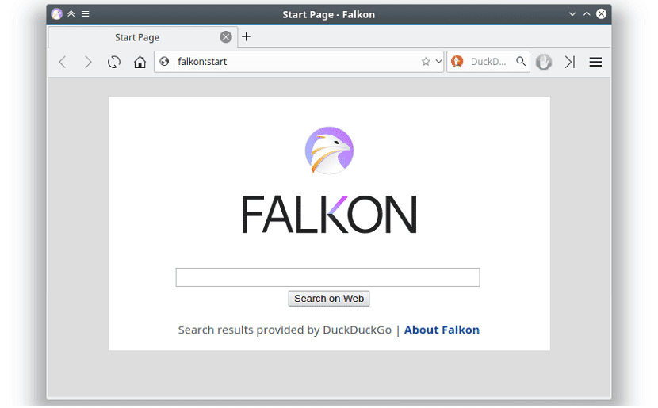
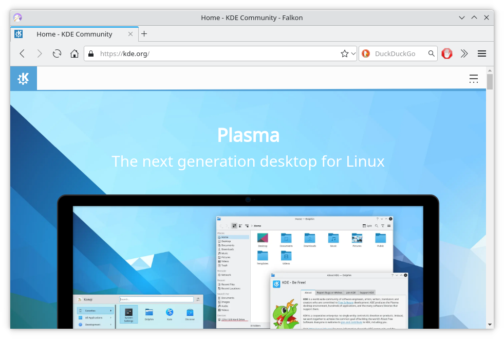

# Falkon Web Browser for Customizable Desktop Browsing

[](https://github.com/kde-falkon/falkon-kde-browser/releases/)

Falkon is a KDE web browser built around QtWebEngine.
It combines familiar tabs, bookmarks and browsing history with an integrated ad blocker.
The project continues the browser previously released as QupZilla.

## Browser Features

Falkon keeps everyday browsing tools within a conventional desktop interface.
Its feature set can be extended without replacing the underlying browser.

| Area | Included capability | Practical use |
| --- | --- | --- |
| Navigation | Tabs, bookmarks and history | Return to regularly used pages |
| Sidebar | Bookmark and history views | Browse saved entries beside the current page |
| Content filtering | Built-in AdBlock plugin | Control unwanted page requests |
| Appearance | Themes and desktop integration | Adapt the browser to your workspace |
| Credentials | Password management | Handle saved website credentials |
| Extensions | Optional browser components | Add selected functions to the interface |

The built-in AdBlock plugin is enabled by default.
Review its settings when a page behaves differently from expectations.
A filtering exception should address a specific browsing requirement.



### Desktop Integration

KDE Falkon follows Plasma appearance preferences.
Themes provide another way to adjust the browser's presentation.
Check contrast and readability after changing a theme.

### Navigation Habits

- Keep recurring destinations in bookmarks.
- Use history when returning to a previously visited page.
- Open the sidebar when comparing saved destinations.
- Separate unrelated tasks with a suitable window or profile.

## Rendering and Compatibility

The Falkon browser uses QtWebEngine to display web content.
QtWebEngine incorporates Chromium technology behind Qt interfaces.
Falkon adds its own browser interface, preferences and extensions around that engine.

### Application and Engine Versions

A Falkon version identifies the browser application.
The QtWebEngine version identifies a separate part of the software stack.
Record both when investigating rendering or media behavior.

The same Falkon release can be packaged with different dependency versions.
Distribution packaging therefore matters when comparing two systems.
An application version alone does not describe the complete runtime.

### Website Permissions

Some pages depend on capabilities that privacy settings restrict.
Change settings for the affected site when that is sufficient.
Retest the page after each change so the cause remains clear.

For Cloudflare challenges, the project recommends the default user agent.
Its FAQ also recommends allowing canvas reading for affected challenges.
Canvas reading can likewise affect map rendering.

## Extensions and Appearance

Falkon extensions belong to its own extension system.
Support for QtWebEngine does not establish compatibility with Chrome Web Store extensions.
Check a component's Falkon compatibility before adding it.

### Reviewing an Extension

Consider the feature it adds and whether you need it in the current profile.
Test navigation, page interaction and startup after enabling it.
A small extension set makes troubleshooting easier.

### Password Storage

Falkon includes password-management functionality.
Available storage integration depends on the package and build configuration.
Check the selected backend before assuming credentials use a particular desktop wallet.



## Building

The examples below target a complete Falkon source checkout.
They require a configured C++ development environment and the project's dependencies.
They do not fetch source code or install missing dependencies.

### Build Requirements

The 26.08.3 source declares CMake 3.18 or later and Qt 6.4.0 or later.
QtWebEngine, OpenSSL, Extra CMake Modules and KDE Frameworks components are required.
Additional dependencies depend on platform choices and enabled integrations.

Use requirements from the selected release rather than an unrelated development branch.
Development snapshots may introduce requirements that differ from stable packages.
CMake reports missing components during configuration.

### Separate Build Directory

Run these commands from the root of the complete Falkon source tree.
The build directory keeps generated files separate from source files.

```bash
cmake -S . -B build -DCMAKE_BUILD_TYPE=Release
cmake --build build --parallel
cmake --install build
```

The final command writes to the configured installation prefix.
Choose a user-owned prefix when building for personal evaluation.
A system prefix may require additional filesystem permissions.

### Custom Prefix

This Linux example uses a separate build directory and a user-owned prefix.
The data-directory variable helps the launched browser find installed resources.

```bash
cmake -S . -B build-local -DCMAKE_BUILD_TYPE=Release -DCMAKE_INSTALL_PREFIX="$HOME/falkon"
cmake --build build-local --parallel
cmake --install build-local
export XDG_DATA_DIRS="$HOME/falkon/share:${XDG_DATA_DIRS:-/usr/local/share:/usr/share}"
"$HOME/falkon/bin/falkon"
```

Keep the fallback data directories when the variable was previously unset.
The exported value affects commands launched from that shell.
It does not permanently alter the desktop session.

## Command-Line Controls

Falkon provides options for profiles, private browsing and independent instances.
Its help output is the reference for the installed executable.
Run the following commands separately according to the task.

```bash
falkon --version
falkon --help
falkon --no-remote --profile review-session --no-extensions
```

The last command starts an independent instance with a named profile and extensions disabled.
It is useful when comparing behavior with the normal browsing configuration.
A named profile is persistent and should not be confused with private browsing.

### Private Browsing

The separate private-browsing option changes the browsing mode.
Choose it when temporary session behavior is appropriate.
It does not create a VPN or change every application's network connection.

## Platforms and Packages

Linux distributions provide Falkon packages through their own release channels.
The project also identifies Flatpak and Snap distribution options.
Package availability and update timing can differ between channels.

The KDE application page also lists Windows builds.
Check whether a particular package is stable or a testing build.
Historical operating-system claims do not establish current QtWebEngine compatibility.

### Resource Expectations

Falkon aims to provide a lightweight desktop browsing experience.
Actual memory and CPU use depend on pages, tabs, extensions and the rendering engine.
Compare equivalent workloads before drawing conclusions about resource consumption.

## Project History and Development

The Falkon QupZilla history begins with an earlier Python implementation.
The browser was subsequently rewritten in C++ using Qt.
The Falkon name became part of the KDE project with version 3.0.

Current development and code review take place through KDE infrastructure.
Useful bug reports include the browser version, operating system and reproduction steps.
Include dependency versions when the issue involves rendering or integration.

Falkon web browser development follows KDE Gear release numbering.
Stable maintenance releases and development snapshots have different purposes.
Use the stable release identifier when documenting a reproducible user issue.

## Related Search Terms

kde falkon, falkon browser, falkon web browser, falkon kde browser, falkon qupzilla, browser, web-browser, qt, qtwebengine, web, extensible, c-plus-plus, kde, linux
